# Settings Window

The settings window lets you change mosaico without editing TOML files. It is a
separate program, `mosaico-settings.exe`, installed beside `mosaico.exe`.

## Opening It

- Click the mosaico icon in the notification area, or pick **Settings…** in
  its menu.
- Run `mosaico settings` from a terminal.
- Double-click `mosaico-settings.exe` in the install folder.

The daemon does not need to be running, and starting the daemon does not open
the window. Only one settings window opens at a time: opening it again brings
the one already open to the front.

The window tiles like any other window. To float it instead, add a rule to
`user-rules.toml`:

```toml
[[rule]]
match_path = "mosaico-settings.exe"
action = "float"
```

## Layout

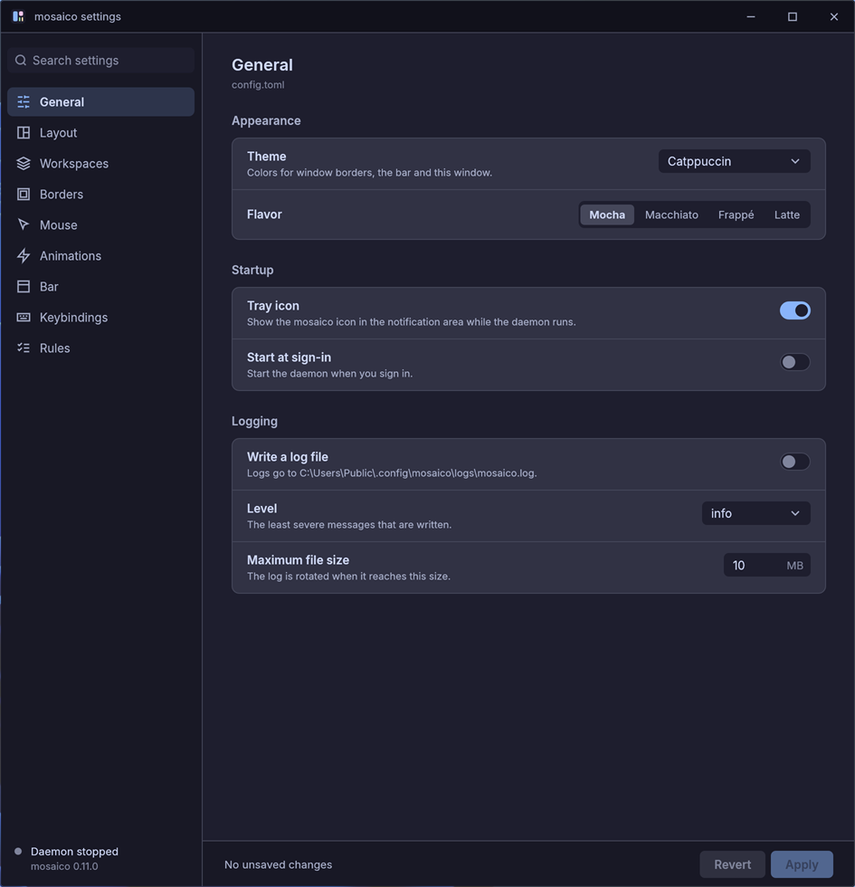

The sidebar lists the pages and has a search field that filters the settings
on the current page by name and description. Under the pages it shows whether
the daemon is running and which version it is.

Each setting shows its default value, and a reset button appears next to any
setting that is not at its default. The footer counts your unsaved changes,
and **Revert** drops them all. Closing the window with unsaved changes, by its
close button, Alt+F4 or the taskbar, asks first: **Keep editing** goes back
to the window and **Discard and close** closes it.

## Saving

**Apply** writes your changes to the configuration file, and the running
daemon picks them up at once, as it does when you edit the file by hand: a
new theme recolors the borders and the bar without a restart. Only the
settings you changed are touched; comments, blank lines and the order of the
file are kept. A setting set back to its default is removed from the file, so
it follows the default if a later version changes it.

While you have no unsaved changes, the window follows edits made to the file
in an editor. If the file has a problem that would stop mosaico loading it,
the window says what it is and shows the defaults, and **Apply** stays
disabled until the file is fixed, so a broken file is never saved over.

## Tray Icon

While the daemon runs, the mosaico icon sits in the notification area.
Windows may put it in the overflow at first; drag it onto the taskbar to keep
it in view. Clicking it opens the settings window. Its menu has:

| Item | What it does |
|------|--------------|
| **Settings…** | Opens the settings window, as a click does |
| **Pause hotkeys** / **Resume hotkeys** | Same as `mosaico pause` and `mosaico unpause` |
| **Reload config** | Loads `config.toml`, `user-rules.toml` and `bar.toml` again |
| **Open config folder** | Opens the folder with the configuration files |
| **Open log** | Opens the log file, when logging is on |
| **Quit mosaico** | Stops the daemon, as `mosaico stop` does |

While the hotkeys are paused the icon is grayed with a red pause badge, and
its tooltip says so. When a configuration file does not load, the icon shows
a notification with the reason, and mosaico keeps the settings it has. The
icon comes back by itself when Explorer restarts. Set `enabled = false` under
`[tray]` in `config.toml` to hide it.

## General

| Section | Setting | File |
|---------|---------|------|
| Appearance | Theme and flavor | `config.toml` |
| Startup | Tray icon (`config.toml`), start at sign-in (registry) | `config.toml`, registry |
| Logging | Write a log file, level, maximum file size | `config.toml` |

Picking a theme or flavor previews it in the settings window right away.

## Layout

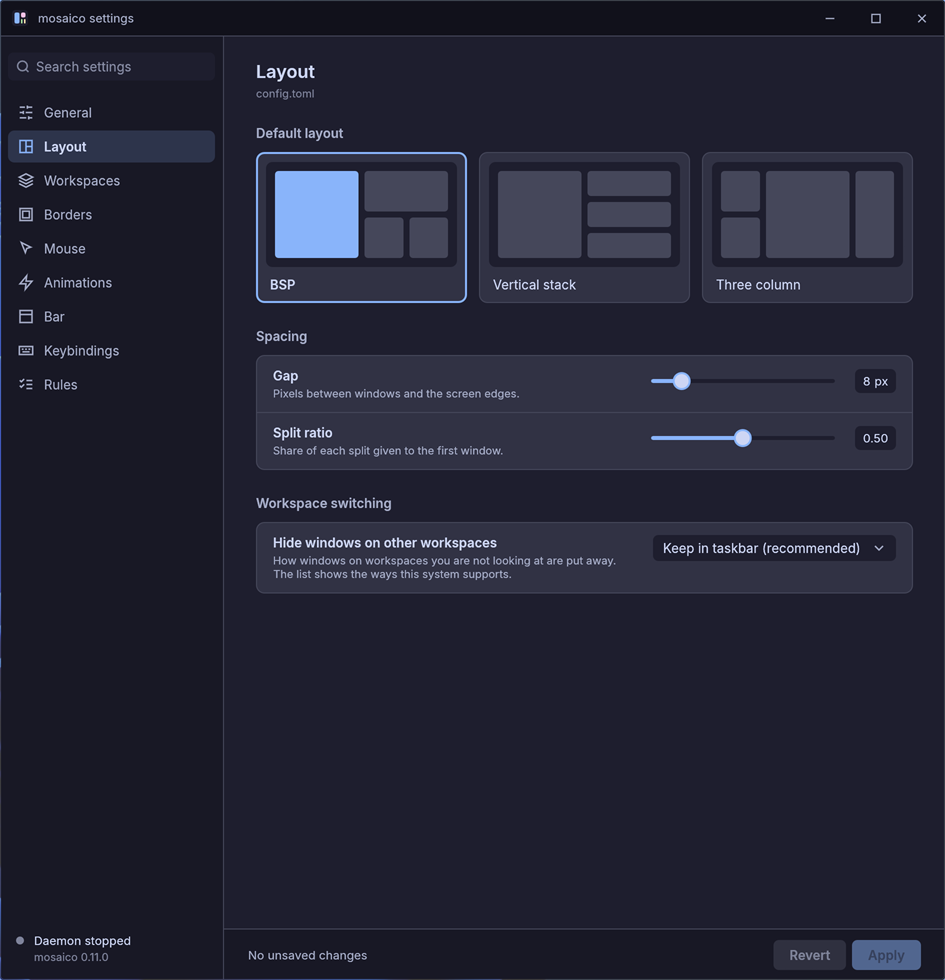

| Section | Setting | Key in `config.toml` |
|---------|---------|----------------------|
| Default layout | A picture of each layout; click one to pick it | `layout.default` |
| Spacing | Gap, split ratio | `layout.gap`, `layout.ratio` |
| Workspace switching | Hide windows on other workspaces | `layout.hiding` |

## Workspaces

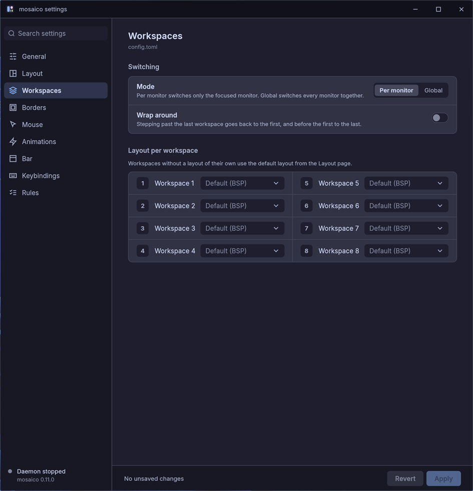

| Section | Setting | Key in `config.toml` |
|---------|---------|----------------------|
| Switching | Mode (per monitor or global) and wrap around | `workspaces.mode`, `workspaces.wrap` |
| Layout per workspace | The layout of each of the eight workspaces, in two columns | `[workspaces.layouts]`, as `1 = "vertical-stack"` |

A workspace shown as dimmed **Default (BSP)** (the name of the default layout)
has no entry in the file, so it follows `layout.default`.

## Borders

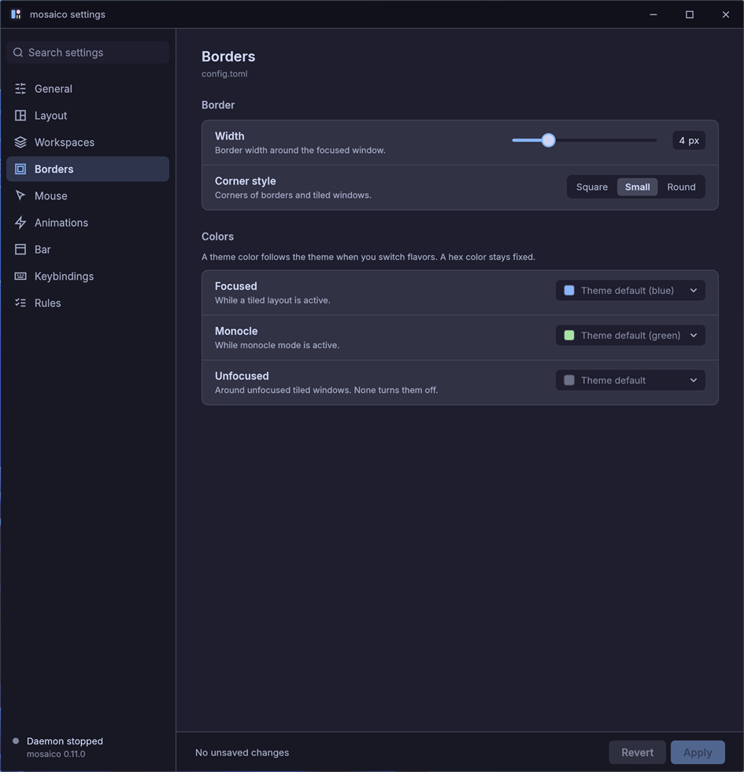

| Section | Setting | Key in `config.toml` |
|---------|---------|----------------------|
| Border | Width, corner style | `borders.width`, `borders.corner_style` |
| Colors | Focused, monocle, unfocused | `borders.colors.focused`, `borders.colors.monocle`, `borders.colors.unfocused` |

Each color is a button with the color's swatch and name. Click it to open the
theme's colors: pick one (the palette changes with the theme), or type a
`#RRGGBB` value; a hex that isn't a color is not taken. "Use the theme default"
goes back to the theme's own color. Unfocused also offers None, which draws no
border on windows without focus.

## Mouse

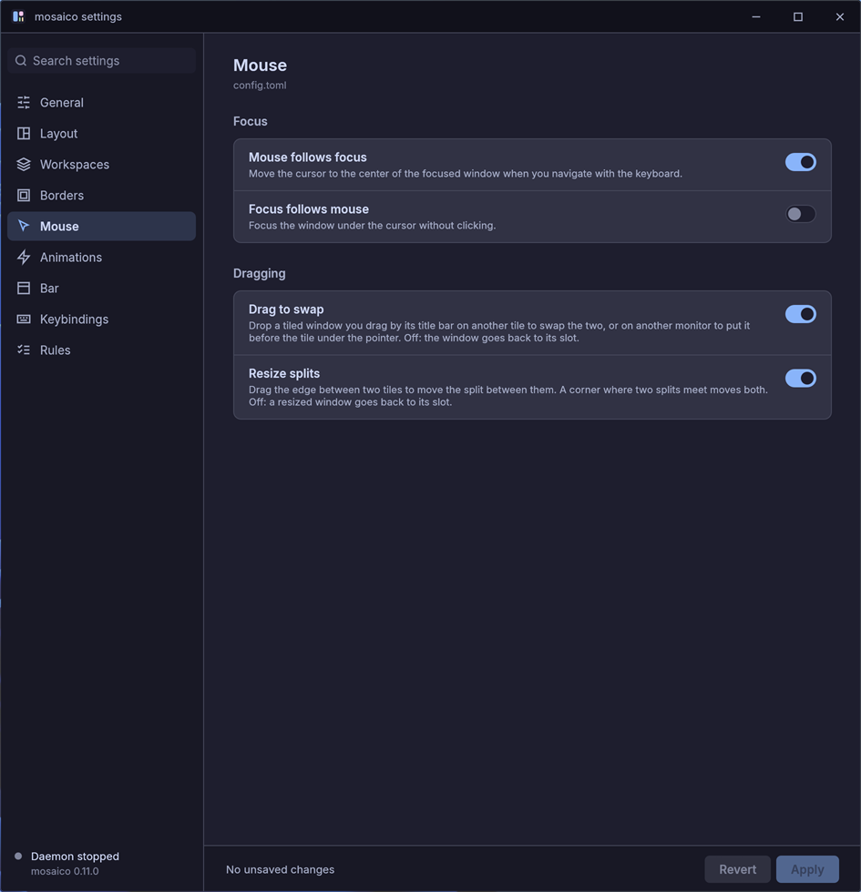

| Section | Setting | Key in `config.toml` |
|---------|---------|----------------------|
| Focus | Mouse follows focus, focus follows mouse | `mouse.follows_focus`, `mouse.focus_follows_mouse` |
| Dragging | Drag to swap, resize splits | `mouse.drag_to_swap`, `mouse.resize_splits` |

## Animations

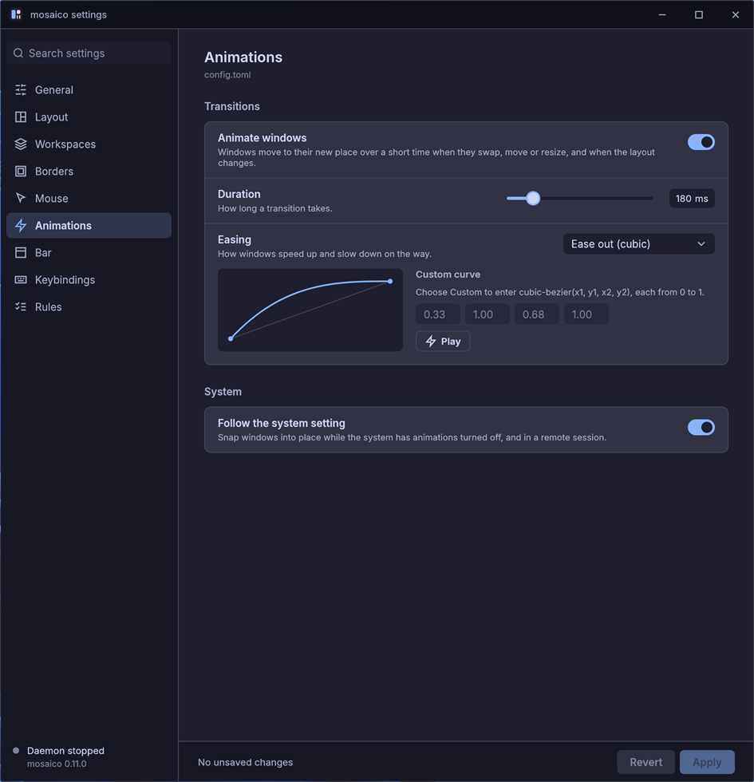

| Section | Setting | Key in `config.toml` |
|---------|---------|----------------------|
| Transitions | Animate windows, duration, easing | `animations.enabled`, `animations.duration`, `animations.easing` |
| System | Follow the system setting | `animations.follow_system` |

Easing lists the presets and **Custom**. A picture of the curve sits under the
row, with its four points as `cubic-bezier(x1, y1, x2, y2)`: a preset shows
the points closest to it, and a custom curve lets you type them, each from 0 to
1. **Play** runs a dot along the curve to show how it moves.

## Bar

The Bar page edits `bar.toml`, a different file from `config.toml`. Apply saves
it after `config.toml`, and the running bar picks the change up by itself.

The page has three tabs, and a preview of the bar at the top of the first two
that follows what you edit before you apply it. The preview draws each widget's
icon as the bar does: the usual widget icons are drawn in lines, so they look the
same whatever font the bar uses.

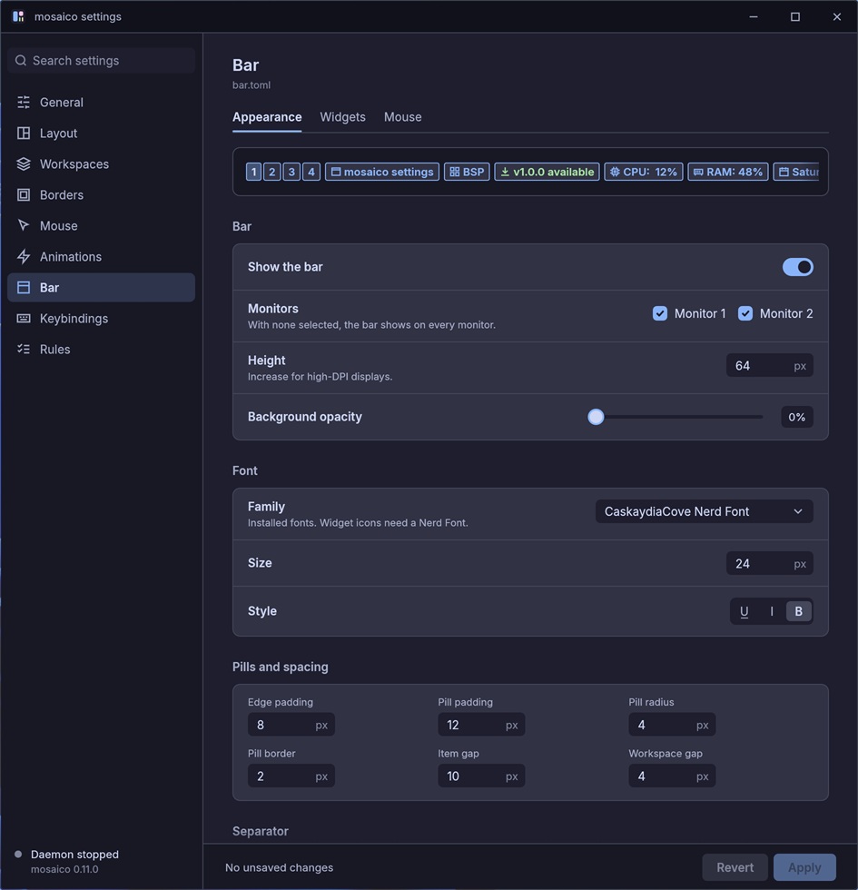

| Tab | Setting | Key in `bar.toml` |
|-----|---------|-------------------|
| Appearance | Show the bar, the monitors it appears on, height, background opacity | `enabled`, `monitors`, `height`, `background_opacity` |
| Appearance | Font family (from the installed fonts), size, bold, italic, underline | `font`, `font_size`, `font_bold`, `font_italic`, `font_underline` |
| Appearance | Pill padding, radius, border width, workspace gap, item gap, separator | `pill_padding`, `pill_radius`, `pill_border_width`, `workspace_gap`, `item_gap`, `separator` |
| Appearance | Background, text, accent and the other bar colors | `colors.*` |
| Widgets | Which widgets are on each side, their order, whether each is on, and its format, icon and color | `[[left]]` and `[[right]]` |
| Mouse | Whether the bar takes clicks and the wheel, what the wheel does, and the click actions | `mouse.enabled`, `mouse.scroll`, `[[mouse.click]]` |

The monitors are ticked by default. Unticking one keeps the bar off it, and
ticking every monitor again removes the list.

On the Widgets tab each side lists its widgets in order. Widgets on the left are
drawn from the left edge and those on the right from the right edge, so moving
one up puts it nearer its edge. Drag the grip at the start of a row to move a
widget, or focus the grip and press the arrow keys: up and down reorder it, left
and right send it to the other side. The switch turns a widget off without
removing it, and clicking a row opens its format, icon and color. Add widget puts
a new one at the end of the side. The bar has no center zone.

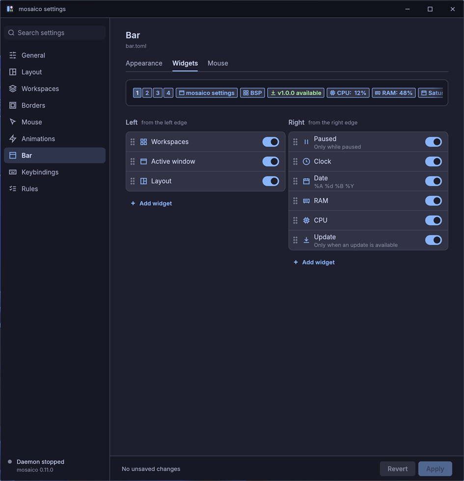

The Mouse tab lists the click actions as a table of widget, button and action.
A click on a workspace number always goes to that workspace.

Saving keeps the comments and the order of the rest of the file, and each widget
keeps its own settings. A `bar.toml` that the bar would not load is shown as a
problem on this page, which stays read-only until the file is fixed; the other
pages are not affected.

## Keybindings

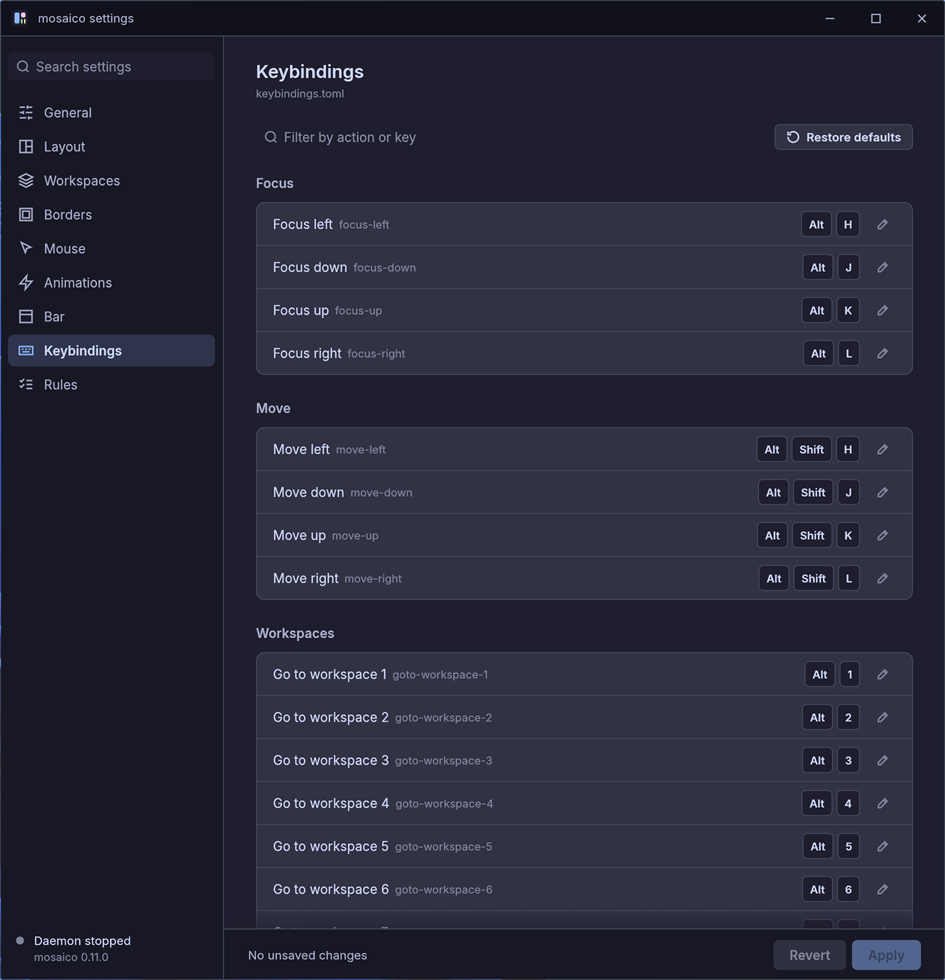

Edits `keybindings.toml`. The hotkeys are grouped as Focus, Move, Workspaces,
Windows and layout, and Mosaico. Each row shows the action, its id in
`keybindings.toml` and its shortcut as keycaps. **Filter by action or key**
narrows the list, and **Restore defaults** puts every action back on its default
shortcut, adding the ones the file lost.

Click the pencil on a row, then press the new shortcut. Hold at least one of
Ctrl, Alt or Shift (function keys can stand alone). The first key you press is
taken; **Esc** cancels. A key mosaico has no name for is refused and the row
keeps waiting. A binding that is not on its default shows a reset button.

If the shortcut you press already belongs to another binding, a banner under the
row says so and offers **Cancel** or **Replace**. Replace gives the shortcut to
this row and removes the other binding until you restore it or revert. If two
bindings in the file share a combination, in any order or case of its
modifiers, both rows are marked **Conflict** and name each other. **Apply**
will not save until one of them is changed. Search matches the action and the
keys, so `alt+j` or `float` narrows the list.

Applying changes only the keys you edited: comments, blank lines, the order
and the line endings of `keybindings.toml` are kept. The daemon picks the new
keys up as it does when you edit the file by hand.

## Rules

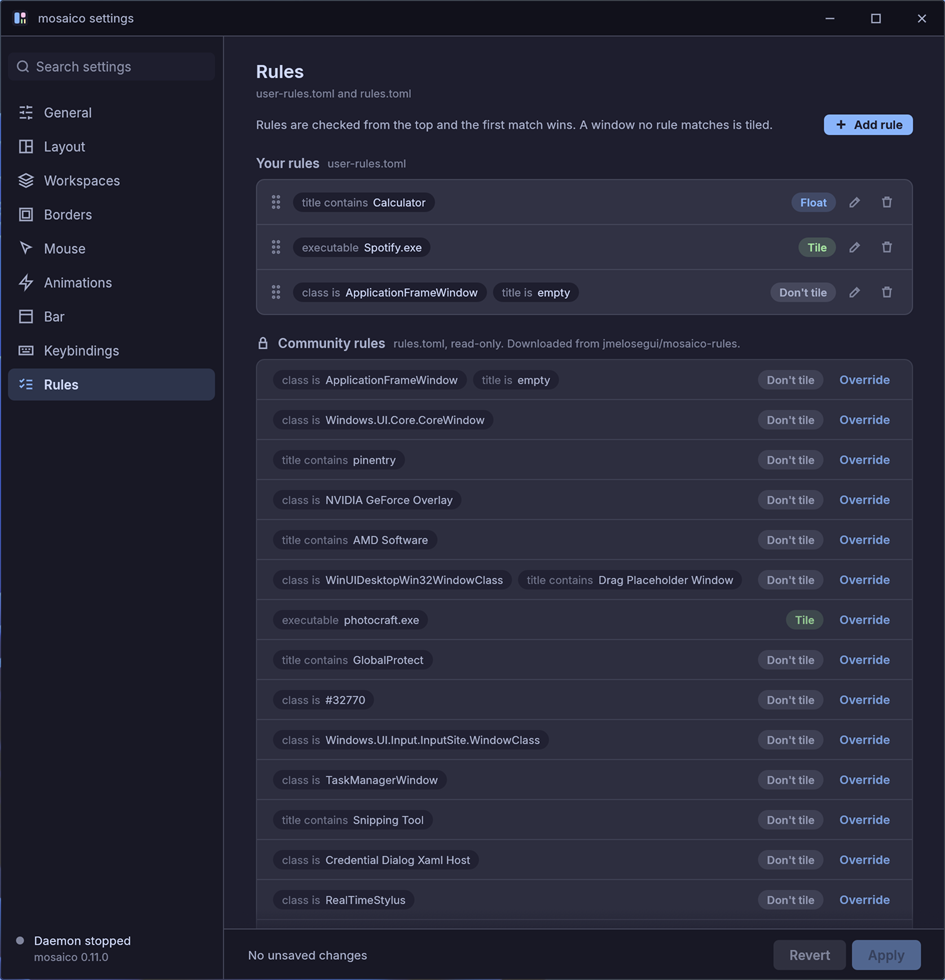

The **Rules** page edits `user-rules.toml` and lists the community rules of
`rules.toml`. **Add rule** in the header adds a rule at the end of your list.
Each of your rules is a row of chips naming what it matches (the window
class, a part of the title, the program path), a **Tile**, **Float** or
**Don't tile** badge, and a pencil and a trash button. The pencil opens an
editor under the row with a field for each match (leave a field empty to match
anything) and a **Tile** / **Float** / **Don't tile** choice; **Done** closes
it. Drag the grip at the start of a row to move the rule, because the first
rule that matches a window decides. A rule needs at least a class, a title or a path before it can be
saved.

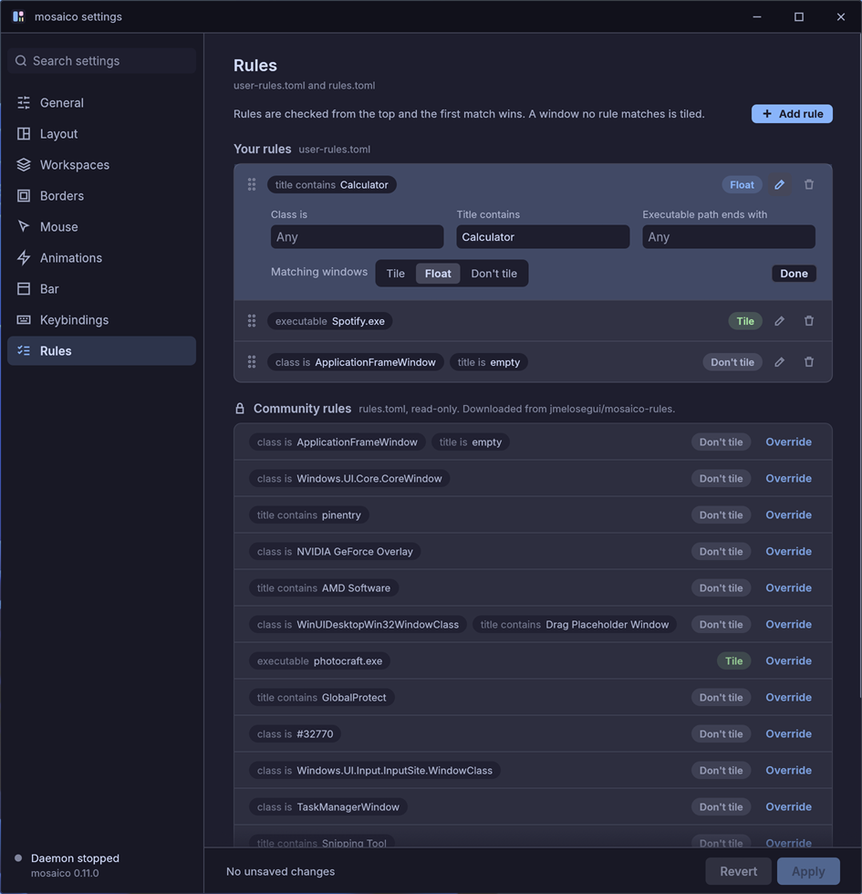

Apply keeps the comments and blank lines of the file, and a rule that moves
takes its comment along. Your rules match before the community rules, which
are listed under **Community rules** with a lock and cannot be edited here.
**Override** copies a community rule into your rules, where you can edit it.
Searching filters both lists by pattern or action.
